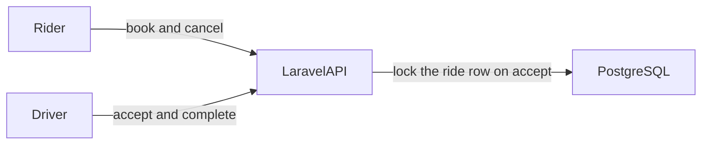

# Architecture

## Authentication

The Vite app on port 5173 and the Laravel API on port 8000 are different origins. Accounts use Laravel Sanctum bearer tokens. The demo stores the token in `localStorage` under `hailryde.token` and sends `Authorization: Bearer` on every API call. A production replacement is an httpOnly cookie so page scripts cannot read the token.

A `401` clears the stored token and shows the login page. Passwords, tokens, and raw authorization headers are not written to the logs.

## Assessment questions

Accounts, sessions, fares, idempotent create, and ride transitions are implemented. The notes below match `docs/specs`.

1. Laravel 13 and PHP 8.4 are the API because Composer blocks Laravel 11 for security advisories. React, TypeScript, and Vite are the UI. PostgreSQL holds riders, drivers, rides, and assignments. Business rules live in actions. Controllers validate input and call one action. Sanctum bearer tokens fit two origins without a shared cookie domain in local development.

2. Accepting a ride takes `SELECT ... FOR UPDATE` on that ride row inside a transaction. A second accept waits, then loses with `409` `lock_timeout` or `invalid_transition` after the first commit. The partial unique index `rides_one_active_per_rider` stops a second active ride for the same rider.

3. `POST /api/rides` requires `Idempotency-Key`. The same key and body return the original ride with `200` and do not insert another row. The same key with a different destination returns `409` `idempotency_conflict`. The book page keeps that key in `sessionStorage` until the attempt settles, and a retry reuses it.

4. Non-OK API responses become `{ code, message, details }`. The UI shows `error.details` on fields and `error.message` otherwise. A failed network call uses `network_error`. While a ride create is in flight the button shows a busy label. When it fails, that label is gone and the error is shown. `401` clears `hailryde.token` and returns to login.

5. Keep one API and one Postgres primary while Lahore is the only city. Add a `city` on places, rides, and driver profiles before opening another city, and route reads to a replica when the primary's read load is the limit. Horizontal API processes stay stateless because the session is a bearer token.

6. Add Redis when token revocation, rate limits, or a hot available-driver cache need to leave Postgres. Add a message broker when acceptance, notifications, or payouts must survive a request process dying. Split services when a team owns a boundary that deploys on its own, such as payments. None of those are in this local demo.

7. Ship with the Compose stack's images behind a reverse proxy, Postgres backups, and health checks on `/up`. Log ride id and status transitions. Roll back by redeploying the previous image and running only backward-compatible migrations. A bad release is reverted by putting the previous API image back, not by editing the database in place.

8. Before production: replace localStorage with an httpOnly cookie, add rate limits on register and login, and run the accept lock test against PostgreSQL in CI.

## Nearby drivers

Nearby-driver discovery for the pickup ETA is the OSRM table over `available` drivers in the ride category. The book and status screens use OpenFreeMap. The public OSRM demo has no uptime guarantee. Accept does not dispatch. It assigns the authenticated driver who calls `POST /api/rides/{id}/accept`, after checking that the driver is available and in the same category.

In production, keep available drivers in a geo index. Offer the ride to the nearest eligible driver, and offer it to the next driver if that one does not accept in time.

## Known limitations

- Routing uses the public OSRM demo, which has no uptime guarantee. When it fails, quotes return `route_unavailable` and the pickup ETA is null.
- A driver accepts their own ride. The server does not dispatch the nearest driver.
- The demo token lives in `localStorage`. A production client would use an httpOnly cookie.
- The status page polls every 3 seconds. It does not use a push channel.
- The build is one city, Lahore, with one API process and one Postgres primary.
- `php artisan test` skips the accept lock test unless `DB_CONNECTION=pgsql`.
