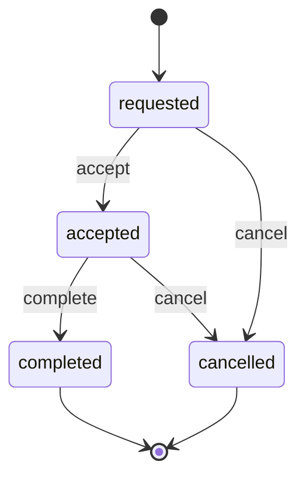

# Ride lifecycle

Any other transition returns `409` with code `invalid_transition`.

Cancel and complete run in one transaction. If the ride has an assigned driver whose status is `on_trip`, set that driver back to `available` in the same transaction.

## Pricing

Config in `backend/config/rides.php`. Currency PKR.

- Economy: base 150, 45 per km, 5 per minute
- Comfort: base 250, 70 per km, 8 per minute

The trip is priced from the driving route between the two pins, fetched from the road router (OSRM `route` request with full GeoJSON geometry).

- `distance_km` is route metres / 1000, rounded to 2 decimal places.
- `duration_min` is `max(1, round(route seconds / 60))`.
- `fare_amount` is `base + per_km * distance_km + per_min * duration_min`, rounded to 2 decimal places.
- The client fare is ignored. The server recomputes it on estimate and on create.
- The quote includes `route`, the GeoJSON `LineString` of the driving route. Create stores it on the ride.

If the router reports no road connection, the response is `422` code `no_route`. If the router times out, cannot be reached, or returns any other failure, the response is `503` code `route_unavailable`.

Pickup ETA uses one router table request: the `available` drivers of the same category are the sources and the pickup is the single destination, annotated with duration. `pickup_eta_min` is `max(3, ceil(smallest finite duration in minutes))`. If no such driver exists, the table request fails, or no duration is finite, `pickup_eta_min` is null and the fare is still returned. The table request is not made when there are no such drivers.

## Create

Require header `Idempotency-Key` (1 to 255 characters). The server rounds each coordinate to 6 decimal places and formats it as a string with 6 decimals. `request_hash` is the SHA-256 hex of the canonical JSON object `{ "pickup_lat", "pickup_lng", "destination_lat", "destination_lng", "category" }` with those keys in that order and those string values.

- Same rider, same key, same hash: return the original ride with `200`. Do not create a second row.
- Same rider, same key, different hash: `409` code `idempotency_conflict`.
- Rider already has a ride in `requested` or `accepted`: `409` code `active_ride_exists`, `details.ride_id` is the existing ride. This is enforced by the partial unique index as well as a check inside the transaction.
- Pickup and destination must differ after rounding, otherwise `422`.

Store the quote fields on the ride at create time. Do not assign a driver during create. Status is `requested`.

## Accept

Inside one transaction, lock in this order only: the ride row, then the authenticated driver's `driver_profiles` row. Do not lock a driver before the ride. Set `lock_timeout` to `3s` for the transaction. A lock wait that expires returns `409` code `lock_timeout`.

1. `SELECT` the ride `FOR UPDATE`.
2. If this driver already has the assignment and the status is `accepted`, return that ride with `200`.
3. If the status is not `requested`, return `409` `invalid_transition`.
4. `SELECT` the driver profile `FOR UPDATE`. If status is not `available`, return `409` `driver_unavailable`. If category does not equal the ride category, return `409` `category_mismatch`.
5. Insert `driver_assignments`, set the ride to `accepted` with `accepted_at`, set the driver to `on_trip`.

The unique `ride_id` on assignments is a backstop. The second accept blocks on the ride lock, then sees `accepted` and returns `409`.

Nearby-driver discovery in this build is the road-time ranking used for ETA only. Accept assigns the authenticated driver who called it.

## Complete and cancel

Complete is allowed only for the assigned driver, and only from `accepted`. Set `completed_at`.

Cancel is allowed only for the rider who owns the ride, and only from `requested` or `accepted`. Set `cancelled_at`.
